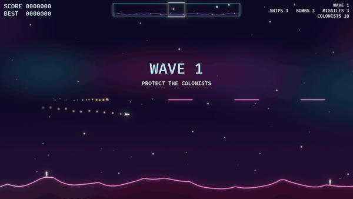
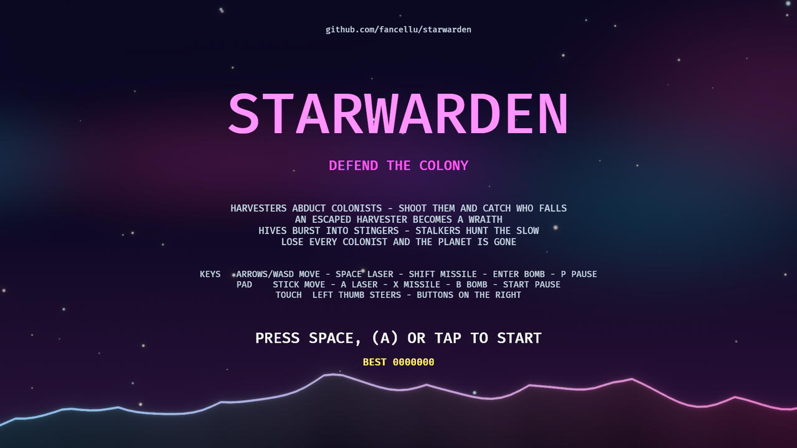
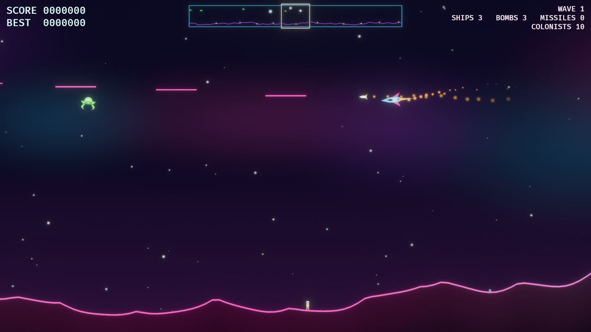
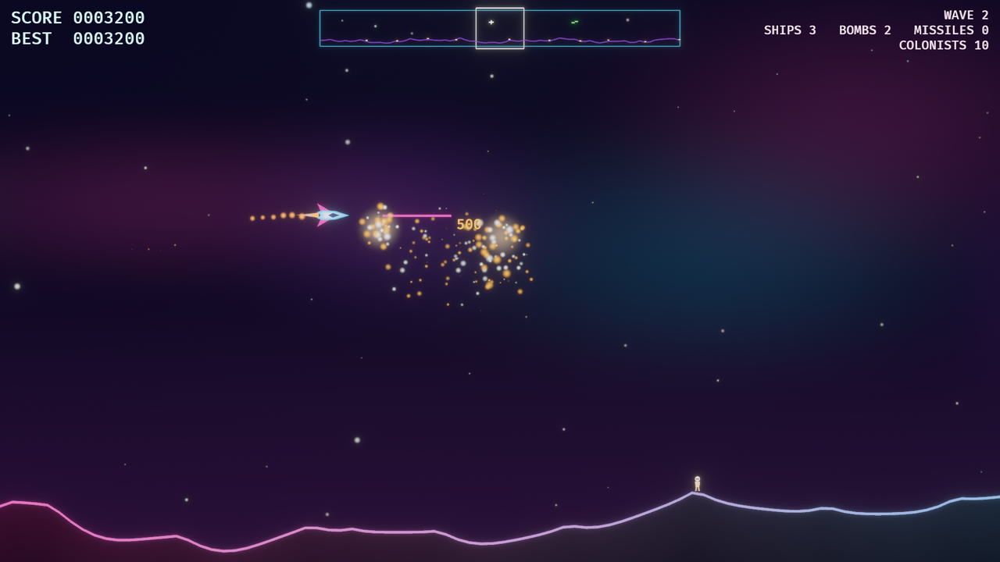
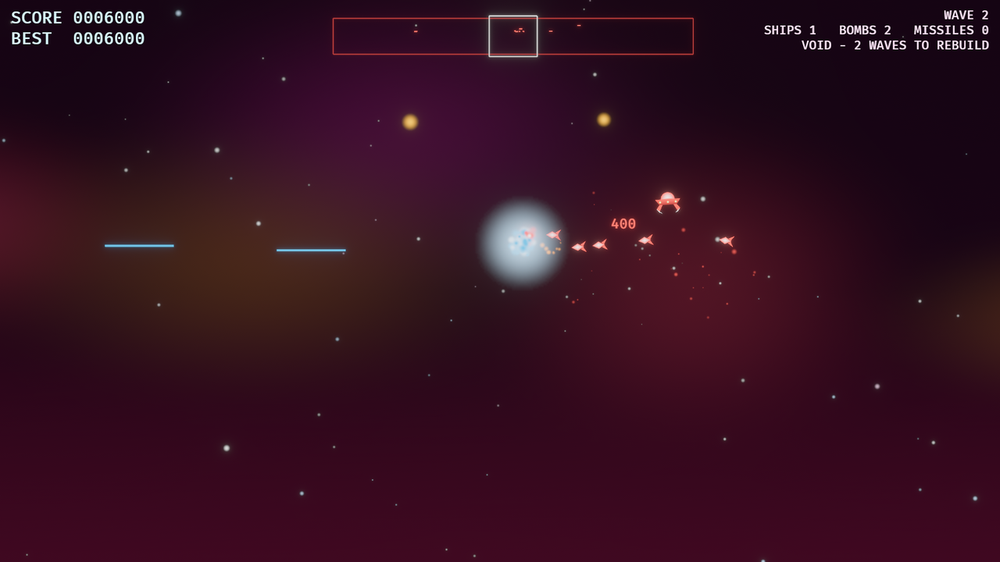

# Starwarden

A side-scrolling planet-defence shooter written in Rust with [Bevy](https://bevyengine.org) 0.20.
It runs on the desktop and in the browser (WebAssembly), and plays with keyboard, gamepad or
touch.

All art, terrain and sound effects are generated in code. There are no asset files.



| | |
| --- | --- |
|  |  |
|  |  |

## How to play

You patrol a small planet that wraps around: keep flying in one direction and you come back to
where you started. The scanner at the top of the screen shows the whole world.

- **Harvesters** (green) descend, grab a colonist and carry them upward.
- Shoot the Harvester and the colonist falls. **Fly into them to catch them**, then fly low to
  set them down. A short fall is survivable; a long one is not.
- A Harvester that reaches the top with a colonist becomes a **Wraith** (magenta): fast,
  erratic and aggressive.
- **Hives** (amber hexagons) take several hits and burst into a swarm of **Stingers**.
- Take too long over a wave and **Stalkers** (blue) come hunting.
- Lose every colonist and the planet is destroyed. You then fight three waves of red **elite**
  enemies in the void; survive them and the planet is rebuilt with new colonists.

Weapons: a rapid-fire laser, a limited stock of homing missiles (two more each wave) and smart
bombs that destroy everything on screen. Every 10,000 points earns an extra ship and bomb.

## Controls

| Action     | Keyboard                | Gamepad                | Touch                   |
| ---------- | ----------------------- | ---------------------- | ----------------------- |
| Move       | Arrow keys or WASD      | Left stick or D-pad    | Drag on the left half   |
| Laser      | Space (also J, Z)       | A / right trigger      | FIRE button (hold)      |
| Missile    | Shift (also X, K)       | X / left trigger / RB  | MISSILE button          |
| Smart bomb | Enter (also B, L)       | B / Y / LB             | BOMB button             |
| Pause      | P or Escape             | Start                  | Pause button, top right |
| Start      | Space or Enter          | A or Start             | Tap anywhere            |

The touch controls appear after the first touch.

## Run on the desktop

```sh
cargo run --release
```

The first build compiles Bevy and takes a few minutes. `cargo run` (without `--release`) also
works and is quicker to rebuild while changing the code.

## Run in the browser

One-time setup:

```sh
rustup target add wasm32-unknown-unknown
cargo install trunk
```

Develop with live reload at <http://localhost:8080>:

```sh
trunk serve
```

To try the touch controls on a phone on the same network:

```sh
trunk serve --address 0.0.0.0
```

and open `http://<your-computer's-ip>:8080` on the phone.

## Deploy to the web

```sh
trunk build --release
```

This writes a self-contained static site to `dist/` (`index.html`, one `.js` file and one
`.wasm` file). Upload the contents of that folder to any static host: GitHub Pages, Netlify,
Cloudflare Pages, itch.io (zip the folder) or your own server. Paths are relative, so it works
from a sub-folder too.

The web build uses WebGL2, which every current browser supports. Sound starts after the first
key press, click or tap, because browsers do not allow audio before that.

## Deploy to Vercel

The repository is set up so that Vercel builds the game itself:

- `vercel.json` tells Vercel to run `scripts/vercel-build.sh` and publish `dist/`.
- `scripts/vercel-build.sh` installs Rust and a prebuilt Trunk on the build machine, then runs
  `trunk build --release`.

Either import the Git repository at <https://vercel.com/new> (every push then deploys), or
deploy from this folder:

```sh
npx vercel          # preview deployment; asks you to log in and create the project first time
npx vercel --prod   # production deployment
```

No project settings need changing. Every deployment compiles Bevy from scratch, so expect the
build to take several minutes.

Vercel's build machines run Amazon Linux 2023. To test the build script in the same OS with
Docker (4 CPUs and 8 GB, like Vercel's standard build machine):

```sh
tar -c --exclude=./target --exclude=./dist --exclude=./.git . |
  docker run -i --rm --cpus 4 --memory 8g amazonlinux:2023 bash -c \
  'dnf install -y -q gcc tar gzip </dev/null && mkdir /app && cd /app && tar -x && bash scripts/vercel-build.sh'
```

## Project layout

| File                | What it does                                                    |
| ------------------- | --------------------------------------------------------------- |
| `src/main.rs`       | App setup, camera and bloom, system ordering                    |
| `src/consts.rs`     | Tuning values, names and colours: the place to tweak the game   |
| `src/world.rs`      | Wrap-around maths, camera follow, screen shake, random numbers  |
| `src/input.rs`      | Keyboard, gamepad and touch merged into one input               |
| `src/player.rs`     | Ship flight model, death and respawn                            |
| `src/weapons.rs`    | Laser, homing missiles, smart bomb                              |
| `src/enemies.rs`    | Enemy behaviour, enemy shots, damage and scoring                |
| `src/colonists.rs`  | Walking, abduction, falling and rescue                          |
| `src/waves.rs`      | Wave contents and progression, the void phase, new games        |
| `src/terrain.rs`    | Planet surface height function and mesh                         |
| `src/background.rs` | Sky, nebula and parallax stars                                  |
| `src/fx.rs`         | Particles and score pop-ups                                     |
| `src/meshes.rs`     | Procedural ship, enemy and colonist shapes                      |
| `src/audio.rs`      | Sound synthesis and playback                                    |
| `src/hud.rs`        | Score display, scanner, banners, touch buttons                  |
| `src/menus.rs`      | Title, pause and game-over screens                              |
| `src/dev.rs`        | Desktop-only self-playing demo that saves screenshots           |

## Development

```sh
cargo test      # unit tests for the game rules, wrap maths, wave tables and audio encoding
cargo clippy
```

Self-playing demo with screenshots (desktop only), useful for checking a change visually:

```sh
STARWARDEN_DEMO=./shots cargo run
```

Optional extras: `STARWARDEN_DEMO_SECS=60` sets the run length, `STARWARDEN_DEMO_EVERY=0.08`
sets the seconds between screenshots (default 2.5), `STARWARDEN_DEMO_VOID=1` forces the void
phase, and `STARWARDEN_DEMO_GALLERY=1` lines up every enemy type. The output folder must
already exist.

The images in `docs/` were made this way. The animation is the frames of a run at 0.08 s
intervals joined with ffmpeg:

```sh
ffmpeg -framerate 12.5 -i shots/shot%03d.png -vf "fps=10,scale=600:-1:flags=lanczos,split[a][b];[a]palettegen=max_colors=128[p];[b][p]paletteuse=dither=bayer:bayer_scale=5" docs/demo.gif
```

## Known limits

- The best score is kept only until the game is closed.
- Sound effects only; there is no music.
